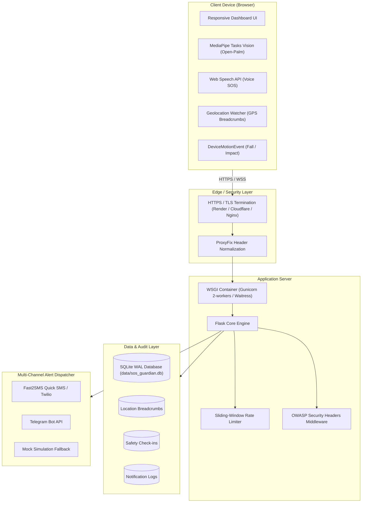

# SOS Guardian — Production Deployment & Operations Guide

This guide provides end-to-end instructions for deploying **SOS Guardian** into a reliable, secure, production-grade emergency assistance platform.

---

## 1. System Architecture Overview

SOS Guardian is architected with a decoupled, high-resilience topology designed for mission-critical availability:



---

## 2. Critical HTTPS Requirement for Emergency Sensors

> [!IMPORTANT]
> Modern web browsers (Chrome, Safari, Edge, Firefox) enforce strict **Secure Context (`isSecureContext`)** policies.
> 
> The following sensor capabilities are **permanently blocked** on non-HTTPS origins (except `localhost` / `127.0.0.1`):
> 1. **Web Camera API (`navigator.mediaDevices.getUserMedia`)** — Required for Open-Palm Gesture detection.
> 2. **Web Speech API (`webkitSpeechRecognition`)** — Required for Voice SOS detection.
> 3. **Browser Geolocation API (`navigator.geolocation`)** — Required for GPS pins and continuous breadcrumb streaming.
> 4. **Device Motion & Orientation API (`DeviceMotionEvent`)** — Required for Fall and Impact detection.
>
> **You MUST serve SOS Guardian over HTTPS (`https://`) in production.**

---

## 3. Option A: Deploying on Render.com (Recommended)

Render provides automatic HTTPS certificates, zero-maintenance reverse proxying, and managed persistent disks.

### Method 1: Infrastructure-as-Code (Render Blueprint)
1. Fork or push the SOS Guardian repository to your GitHub account.
2. In the [Render Dashboard](https://dashboard.render.com/), click **New +** -> **Blueprint**.
3. Connect your repository. Render will automatically detect [`render.yaml`](file:///c:/Users/DELL/OneDrive/Desktop/SOS-Guardian/render.yaml).
4. Review the auto-configured service:
   - **Service Name**: `sos-guardian`
   - **Environment**: `Python`
   - **Build Command**: `pip install -r requirements.txt`
   - **Start Command**: `gunicorn wsgi:app --workers 2 --bind 0.0.0.0:$PORT`
   - **Health Check Path**: `/health`
   - **Disk Mount**: `/var/data` (1 GB persistent storage for SQLite)
5. Click **Apply**. Render will build and deploy the service with an auto-provisioned SSL certificate (`https://sos-guardian.onrender.com`).

### Method 2: Manual Web Service Setup on Render
If configuring manually via the Render UI:
1. Click **New +** -> **Web Service**.
2. Select **Build and deploy from a Git repository**.
3. Configure the settings:
   - **Language**: `Python`
   - **Branch**: `master` or `main`
   - **Build Command**: `pip install -r requirements.txt`
   - **Start Command**: `gunicorn wsgi:app --workers 2 --bind 0.0.0.0:$PORT`
4. Under **Advanced** -> **Disks**:
   - Click **Add Disk**.
   - **Name**: `sos-guardian-data`
   - **Mount Path**: `/var/data`
   - **Size**: `1 GB`
5. Under **Environment Variables**, add:
   | Key | Recommended Production Value | Description |
   |---|---|---|
   | `FLASK_ENV` | `production` | Enforces production security flags |
   | `FLASK_SECRET_KEY` | *(Generate 32-byte hex)* | Protects session cookies |
   | `SESSION_COOKIE_SECURE` | `true` | Enforces HTTPS-only cookies |
   | `DATABASE_PATH` | `/var/data/sos_guardian.db` | Points to persistent disk mount |
   | `SMS_PROVIDER` | `fast2sms` | Enables zero-cost live SMS delivery |
   | `FAST2SMS_API_KEY` | `your_fast2sms_api_key` | Free signup API key |
   | `TELEGRAM_BOT_TOKEN` | `your_bot_token` | Optional Telegram bot token |
   | `PROXY_FIX_FOR` | `1` | Reads client IP from Render reverse proxy |
   | `PROXY_FIX_PROTO` | `1` | Identifies HTTPS protocol from proxy |

---

## 4. Option B: Deploying on Linux VPS (Ubuntu 22.04 / Debian 12)

### Step 1: Install System Dependencies
```bash
sudo apt update && sudo apt upgrade -y
sudo apt install -y python3.11 python3.11-venv python3-pip git nginx certbot python3-certbot-nginx
```

### Step 2: Clone and Set Up Repository
```bash
cd /opt
sudo git clone https://github.com/your-username/SOS-Guardian.git sos-guardian
cd sos-guardian
sudo python3.11 -m venv .venv
sudo .venv/bin/pip install --upgrade pip
sudo .venv/bin/pip install -r requirements.txt
```

### Step 3: Configure Environment Variables
```bash
sudo cp .env.production.example .env
sudo nano .env
```
Generate a secure secret key:
```bash
python3 -c "import secrets; print(secrets.token_hex(32))"
```
Ensure directory permissions:
```bash
sudo chown -R www-data:www-data /opt/sos-guardian
sudo chmod -R 775 /opt/sos-guardian/data
```

### Step 4: Verify Database Initialization
```bash
sudo -u www-data /opt/sos-guardian/.venv/bin/python /opt/sos-guardian/scripts/init_prod_db.py
```

### Step 5: Configure systemd Service
Create `/etc/systemd/system/sos-guardian.service`:
```ini
[Unit]
Description=SOS Guardian Emergency Assistance Service
After=network.target

[Service]
User=www-data
Group=www-data
WorkingDirectory=/opt/sos-guardian
Environment="PATH=/opt/sos-guardian/.venv/bin"
EnvironmentFile=/opt/sos-guardian/.env
ExecStart=/opt/sos-guardian/.venv/bin/gunicorn wsgi:app \
    --workers 2 \
    --threads 4 \
    --bind 127.0.0.1:5000 \
    --access-logfile /var/log/sos-guardian-access.log \
    --error-logfile /var/log/sos-guardian-error.log

Restart=always
RestartSec=5s

[Install]
WantedBy=multi-user.target
```

Enable and start the service:
```bash
sudo systemctl daemon-reload
sudo systemctl enable sos-guardian
sudo systemctl start sos-guardian
sudo systemctl status sos-guardian
```

### Step 6: Configure Nginx with SSL
Create `/etc/nginx/sites-available/sos-guardian`:
```nginx
server {
    server_name emergency.yourdomain.com;

    client_max_body_size 2M;

    location / {
        proxy_pass http://127.0.0.1:5000;
        proxy_set_header Host $host;
        proxy_set_header X-Real-IP $remote_addr;
        proxy_set_header X-Forwarded-For $proxy_add_x_forwarded_for;
        proxy_set_header X-Forwarded-Proto $scheme;

        # WebSocket & Streaming support for real-time tracking
        proxy_http_version 1.1;
        proxy_set_header Upgrade $http_upgrade;
        proxy_set_header Connection "upgrade";
    }

    # Static caching
    location /static/ {
        alias /opt/sos-guardian/static/;
        expires 30d;
        add_header Cache-Control "public, no-transform";
    }
}
```

Enable site and acquire free SSL:
```bash
sudo ln -s /etc/nginx/sites-available/sos-guardian /etc/nginx/sites-enabled/
sudo nginx -t
sudo systemctl restart nginx
sudo certbot --nginx -d emergency.yourdomain.com
```

---

## 5. Option C: Running Production on Windows Server

For on-premises Windows servers or desktop environments, Waitress WSGI provides production concurrency:

```powershell
# In PowerShell:
Set-Item -Path Env:FLASK_ENV -Value "production"
Set-Item -Path Env:SESSION_COOKIE_SECURE -Value "true"
Set-Item -Path Env:PORT -Value "5000"

.venv\Scripts\python.exe wsgi.py
```

To run as an automatic Windows Service, use [NSSM (Non-Sucking Service Manager)](https://nssm.cc/):
```powershell
nssm install SOSGuardian "C:\path\to\SOS-Guardian\.venv\Scripts\python.exe" "C:\path\to\SOS-Guardian\wsgi.py"
nssm set SOSGuardian AppDirectory "C:\path\to\SOS-Guardian"
nssm start SOSGuardian
```

---

## 6. Live SMS Delivery Setup (Fast2SMS Zero-Cost)

1. Create a free account at [https://www.fast2sms.com/](https://www.fast2sms.com/).
2. Upon signup, Fast2SMS grants free starter wallet balance.
3. In the left navigation menu, go to **Dev API** -> copy your API Authorization key.
4. In your `.env` or Render environment settings, configure:
   ```env
   SMS_PROVIDER=fast2sms
   FAST2SMS_API_KEY=your_copied_api_key
   ```
5. Guardian recipients can receive alerts on any Indian mobile phone without installing any application.

---

## 7. Health Check, Liveness Probes & Diagnostics

SOS Guardian provides health endpoints at `/health` and `/api/health`:

```bash
curl -i https://your-domain.com/health
```

### Sample Response (`200 OK`):
```json
{
  "components": {
    "database": "connected",
    "rate_limiter": "active",
    "sms_provider": "fast2sms",
    "telegram": "configured"
  },
  "service": "SOS Guardian",
  "status": "healthy",
  "success": true,
  "timestamp": "2026-11-10T05:25:00.000Z",
  "version": "1.0.0"
}
```

If the database becomes unreachable, the endpoint returns `503 Service Unavailable` with `status: "degraded"`.

---

## 8. Backup & Maintenance Procedures

### SQLite Online Live Backup (Zero Downtime)
SQLite WAL mode allows zero-downtime hot backups while transactions are actively executing:
```bash
sqlite3 data/sos_guardian.db ".backup 'data/backup-$(date +%Y%m%d%H%M%S).db'"
```

### Database Integrity Verification
```bash
sqlite3 data/sos_guardian.db "PRAGMA integrity_check;"
```

### Log File Rotation
When running under systemd or Gunicorn, configure `logrotate` to prevent disk bloat:
```text
/var/log/sos-guardian-*.log {
    daily
    missingok
    rotate 14
    compress
    delaycompress
    notifempty
    create 0640 www-data www-data
}
```

